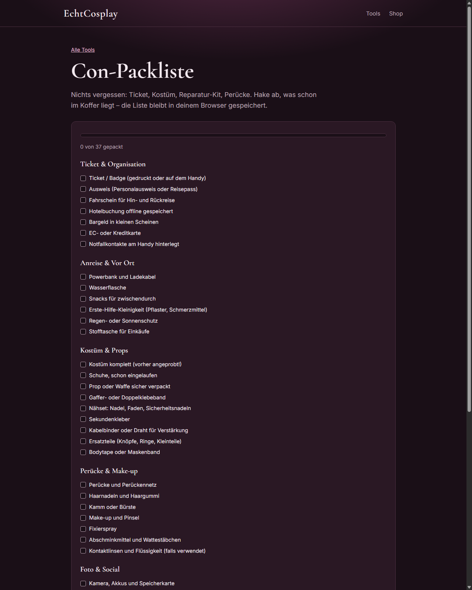
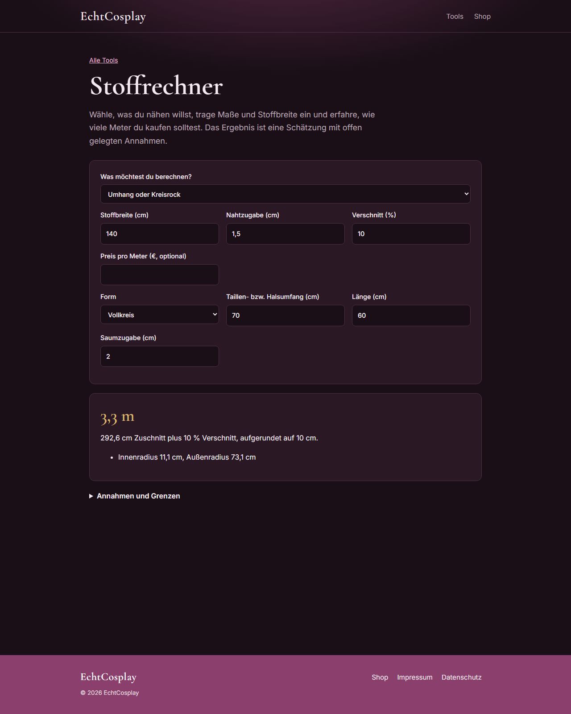

# 🧵 cosplay-calculators

[](LICENSE)
[](https://echtcosplay.de/tools/)

Free, open-source calculators for cosplayers — fabric math, prop scaling, wig lengths and con budgets. Everything runs **in your browser**: no accounts, no uploads, no third-party analytics.

**[Live demos → echtcosplay.de/tools](https://echtcosplay.de/tools/)**


## Tools

| Tool | What it calculates | Live demo |
|---|---|---|
| **Fabric calculator** *(Stoffrechner)* | Meters needed for cloaks, circle skirts, gathered skirts and rectangular pieces — fabric width, seam allowances, waste %, shelf-packing layout | [echtcosplay.de/tools/stoffrechner](https://echtcosplay.de/tools/stoffrechner/) |
| **Circle skirt calculator** *(Kreisrock)* | Cut radius, outer radius, gore count when the fabric is too narrow, waistband fabric | [echtcosplay.de/tools/kreisrock-rechner](https://echtcosplay.de/tools/kreisrock-rechner/) |
| **Prop scaling** *(Prop-Skalierung)* | Rescale weapons and props to your body height | [echtcosplay.de/tools/prop-skalierung](https://echtcosplay.de/tools/prop-skalierung/) |
| **Wig length guide** *(Perücken-Länge)* | See where a wig would end on your body before you buy | [echtcosplay.de/tools/peruecken-laenge](https://echtcosplay.de/tools/peruecken-laenge/) |
| **Con packing checklist** | Curated checklist with progress, custom items and a print-friendly layout | [echtcosplay.de/tools/con-packliste](https://echtcosplay.de/tools/con-packliste/) |
| **Con budget** | Ticket, travel, hotel and food per person — with buffer, shareable via URL | [echtcosplay.de/tools/con-budget](https://echtcosplay.de/tools/con-budget/) |
| **Group budget splitter** | Split cosplay-group costs fairly and compute who pays whom | [echtcosplay.de/tools/budget-rechner](https://echtcosplay.de/tools/budget-rechner/) |


## Why the math is trustworthy

- **Every calculator publishes its assumptions.** Each page ships an *„Annahmen und Grenzen"* section — the formulas, the rounding, and where the estimate breaks down. No black boxes.
- **The fabric layout is a real decision tree**, not a single formula:
  - full circle → 4-layer fold when the fabric is ≥ 2× the outer radius, otherwise two half-circles along the selvedge, otherwise gores;
  - gore count: the smallest of 4/6/8/12/16/24/32 whose hem arc still fits the fabric width, laid out in alternating rows;
  - rectangular pieces are packed with a shelf-packing algorithm before the waste factor is applied.
- **No server, no telemetry.** The site is fully static; shareable calculator state lives in the URL hash.



## Getting started

```bash
npm install
npm run dev      # http://localhost:4321/tools/
npm run build    # static output in dist/
npm run preview  # serve the build locally
```

Astro 5 static site — the UI is German, the same one as the [live demos](https://echtcosplay.de/tools/).



## Contributing

Issues and PRs are welcome — especially new calculators that come with published formulas or sources. If a tool would need an external data source (material databases, price surveys, …), open an issue first so we can agree on sourcing and licensing before any code is written.

## License

[MIT](LICENSE) — free to use, fork and ship, even commercially.

---

Built by [EchtCosplay](https://echtcosplay.de/) — cosplay costumes, wigs and accessories, shipping across Europe. Need costume fabric in bulk? The [shop](https://echtcosplay.de/shop/) is one click away.
